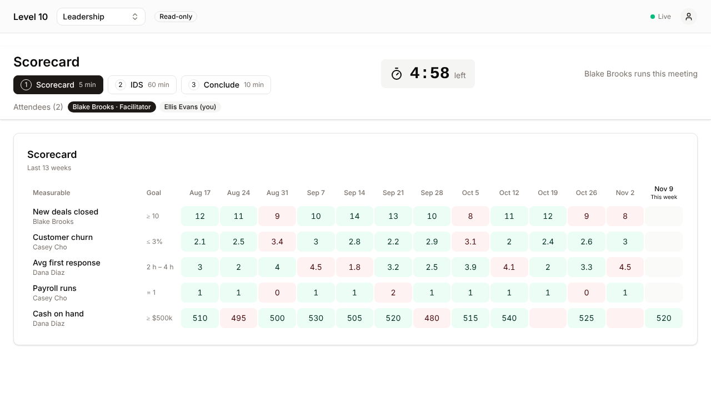

# Level_10_Meeting

## Tests

```bash
tools/test.sh
```

- Runs the server tests (pytest), then the two-browser test (Playwright, `web/e2e/`).
- The two-browser test builds its own database (`<db>_e2e`: migrate, then seed), builds the web app, and starts the server on 8001 and the web app on 3001. Dev servers and dev data are untouched.
- Blake (Team Member) starts the Leadership meeting and Ellis (Observer) joins. Blake moves to IDS, then Conclude, then ends it. Ellis's browser shows each section within 2 seconds, then the summary, and never shows Next or End.

**Failure artifact**: one run with the server's next-section broadcast removed. Blake's browser moved to IDS; Ellis's stayed on Scorecard.

| Facilitator | Second browser |
|---|---|
|  |  |

Full trace: `web/e2e/failure/trace.zip`. Open it at [trace.playwright.dev](https://trace.playwright.dev) or with `pnpm --dir web exec playwright show-trace e2e/failure/trace.zip`.

## Rules report

```bash
tools/report.sh > rules_report.json
APP_NOW=2026-11-18T15:00:00Z tools/report.sh
```

- Prints every value from brief 2.6 as JSON, in the format in `assessment/README.md`.
- Each run builds its own database (`<db>_report`): migrate, seed, compute, drop. Your dev data is untouched. Needs Postgres running and a role that can create databases.
- JSON goes to stdout, logs to stderr.

**Assumptions**
- Every seeded Rock is included, not only the current quarter's.
- Another `APP_NOW` moves only the clock; the data stays as seeded.

## Live connection

One WebSocket per open team page: `ws://<host>/api/live?team_id=<team_id>`. The sign-in cookie identifies the user; the page must be served from the web app's address (`WEB_ORIGIN`). The server ignores anything the browser sends.

**Refused connections** close with code `1008` and one of these reasons:

| Reason | When |
|---|---|
| `Unknown web address` | The page isn't the web app |
| `Choose a user first` | Not signed in |
| `Team not found` | No such team, or one the user can't open |

**Messages from the server**

| `type` | When | Fields |
|---|---|---|
| `hello` | Right after connecting | `user`: who is connected |
| `meeting` | Right after `hello`, then on every start, join, next section, end or rating | `meeting`: the full meeting state, the same as `GET /api/meetings/{id}`, or `null` when none is running |
| `changed` | After any score, Issue or To-Do change on the team, from either page | `what`: `scorecard`, `issues` or `todos`; refetch that list |

```json
{"type": "hello", "user": {"id": "u2", "name": "Blake Brooks"}}
```

```json
{"type": "meeting", "meeting": {"id": "mt3", "team_id": "team_lead", "facilitator": {"id": "u2", "name": "Blake Brooks"}, "attendees": [{"id": "u2", "name": "Blake Brooks"}, {"id": "u5", "name": "Ellis Evans"}], "ratings": [], "rating": null, "started_at": "2026-11-11T15:00:00Z", "ended_at": null, "section": "scorecard", "section_started_at": "2026-11-11T15:00:00Z", "section_ends_at": "2026-11-11T15:05:00Z", "over_time": false, "server_now": "2026-11-11T15:01:30Z"}}
```

```json
{"type": "meeting", "meeting": null}
```

```json
{"type": "changed", "what": "issues"}
```

The browser works out time left and over time from `section_ends_at` and `server_now`.
