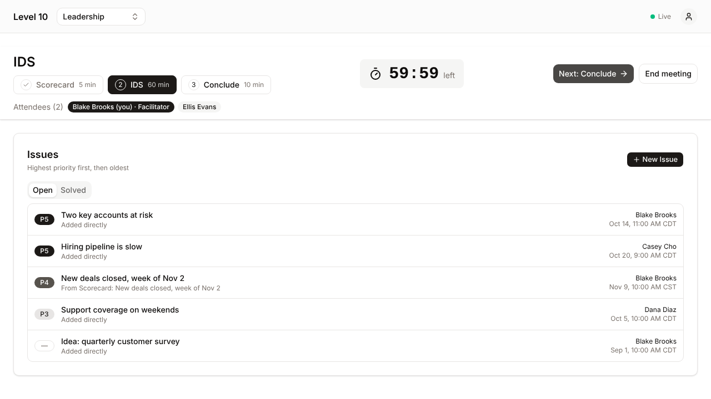

# Level_10_Meeting

- **Decision record:** [DECISIONS.md](DECISIONS.md)
- **Walkthrough video:** _link added with #25_

## Run it

```bash
docker compose up --build
```

- Open http://localhost:3000 and pick a seeded user. API docs: http://localhost:8000/docs.
- No setup needed: every setting has a default. A `.env` (see `.env.example`) overrides any of them; `WEB_PORT` and `API_PORT` change the ports.
- Start order: Postgres, then `migrate` (migrations + seed, then exits), then the API, then the web app. The seed only adds missing rows, so rerunning keeps your changes; `docker compose down -v` resets to the seed.
- The session secret default is for local demos only.
- `tools/compose-check.sh` builds and starts the same stack under its own project name, checks the API docs, the sign-in page, the seeded users and a sign-in through the web app, then removes it. Your own stack and data are untouched. CI runs it on every PR.

**Tracing problems**
- Every response carries an `X-Request-ID` header. `docker compose logs server` shows one JSON line per refused (4xx), failed or crashed (5xx, with traceback) or slow (over `SLOW_REQUEST_MS`, default 500) request, with that id, the user and the error code. Successful requests write nothing. `LOG_LEVEL=WARNING` hides refusals.
- Audit trail: every data change (scores, Issues, To-Dos, meetings, ratings) is saved with who, when and each field's before and after, in the same transaction as the change. Read it at `GET /api/teams/{team_id}/activity`, newest first.

## Tests

```bash
tools/test.sh
```

- Runs the server tests (pytest), the web unit tests (Vitest), then the two-browser test (Playwright, `web/e2e/`).
- The two-browser test builds its own database (`<db>_e2e`: migrate, then seed), builds the web app, and starts the server on 8001 and the web app on 3001. Dev servers and dev data are untouched.
- CI runs the same suite on every PR ([ci.yml](.github/workflows/ci.yml)), plus lint, type check, build, the rules report and the `docker compose up` check.

**Fixture and clock strategy**
- **Database:** each checkout gets its own test database (`level10_test_<checkout hash>`), built fresh per run: migrate, then seed once ([conftest.py#L33](server/tests/conftest.py#L33)).
- **Clean up:** every test undoes its own changes; the two-at-once tests use separate connections, so they delete the rows they made.
- **Proof:** at the end of the run, the seeded rows must match how they started, or the run fails and lists what was left behind ([conftest.py#L121](server/tests/conftest.py#L121)). Tests run in random order, so a hidden dependence on order shows up.
- **Clock:** every test runs on a fixed clock at `APP_NOW` and moves it forward by hand; nothing waits for real time ([conftest.py#L128](server/tests/conftest.py#L128)).

**Two-browser test**
- Blake (Team Member) starts the Leadership meeting and Ellis (Observer) joins. Blake moves to IDS, adds an Issue, moves to Conclude, rates 8, then ends it. Ellis's browser shows each section, the new Issue and the 8.0 average within 2 seconds, then the summary with Blake's rating. Ellis never sees Next, End or the rating buttons.

**Failure artifact**: one run with the server's next-section broadcast removed. Blake's browser moved to IDS; Ellis's stayed on Scorecard.

| Facilitator | Second browser |
|---|---|
|  |  |

Full trace: `web/e2e/failure/trace.zip`. Open it at [trace.playwright.dev](https://trace.playwright.dev) or with `pnpm --dir web exec playwright show-trace e2e/failure/trace.zip`.

## Rules report

```bash
tools/report.sh > rules_report.json
APP_NOW=2026-11-18T15:00:00Z tools/report.sh
```

- Prints every value from brief 2.6 as JSON, in the format in `assessment/README.md`.
- Each run builds its own database (`<db>_report`): migrate, seed, compute, drop. Your dev data is untouched. Needs Postgres running and a role that can create databases.
- JSON goes to stdout, logs to stderr.

## Assumptions

- **Rules report:** every seeded Rock is included, not only the current quarter's. Another `APP_NOW` moves only the clock; the data stays as seeded.
- **Done To-Dos:** ones done before the last closed week started are hidden from the list ([todos/service.py#L33-L37](server/app/modules/todos/service.py#L33-L37)).
- **"During the meeting"** is a time window: what the team solved or created between start and end, both ends included.
- **Admins work on every team, member or not:** change data, own Issues and To-Dos, start, facilitate and rate.
- **Time:** timestamps tick from `APP_NOW` while "today" stays on `APP_NOW`, so timers run and new rows sort.

## Known limitations

- **One server process:** live connections and who's online are held in memory.
- **Sign-out** clears the browser's cookie only; a copied cookie works until it expires (3 idle days, 7 days at most).
- **Past summaries** are worked out when read, so later edits change them. The fix is described in [DECISIONS.md](DECISIONS.md#5-keeping-past-summaries-unchanged-described-not-built).
- **Refreshing after a meeting ends** shows "No meeting running" instead of the summary; the summary is still in the API.
- **Admins can open every team in every company**; fine for the one seeded company.
- **A server crash** loses up to 5 seconds of app time; meetings still end after they start.
- **A live connection closed before its first message** logs a harmless traceback ([live/router.py](server/app/modules/live/router.py)).
- **Not built (bonus):** lost-update protection for scores and Issue priority (last save wins), and Make it an Issue from a Rock or an overdue To-Do.

## AI tools

- **Claude Code** (Anthropic), on my machine and in cloud sessions, with my own mak-kit plugin (private: questions before building, stack research with sources, React and TypeScript guidelines, cleanup and checks before each PR, handoff notes) and the [caveman](https://github.com/JuliusBrussee/caveman) plugin for shorter replies ([settings.json](.claude/settings.json)).
- **Where:** planning the issue backlog, writing the code and tests, browser checks, and PR descriptions. I made the calls in [DECISIONS.md](DECISIONS.md) and reviewed and approved every diff before it was committed.

## Live connection

One WebSocket per open team page: `ws://<host>/api/live?team_id=<team_id>`. The sign-in cookie identifies the user; the page must be served from the web app's address (`WEB_ORIGIN`). The server ignores anything the browser sends.

**Refused connections** close with code `1008` and one of these reasons:

| Reason | When |
|---|---|
| `Unknown web address` | The page isn't the web app |
| `Choose a user first` | Not signed in |
| `Team not found` | No such team, or one the user can't open |

**Messages from the server**

| `type` | When | Fields |
|---|---|---|
| `hello` | Right after connecting | `user`: who is connected |
| `meeting` | Right after `hello`, then on every start, join, next section, end or rating | `meeting`: the full meeting state, the same as `GET /api/meetings/{id}`, or `null` when none is running |
| `changed` | After any score, Issue or To-Do change on the team, from either page | `what`: `scorecard`, `issues` or `todos`; refetch that list |

```json
{"type": "hello", "user": {"id": "u2", "name": "Blake Brooks"}}
```

```json
{"type": "meeting", "meeting": {"id": "mt3", "team_id": "team_lead", "facilitator": {"id": "u2", "name": "Blake Brooks"}, "attendees": [{"id": "u2", "name": "Blake Brooks"}, {"id": "u5", "name": "Ellis Evans"}], "ratings": [], "rating": null, "started_at": "2026-11-11T15:00:00Z", "ended_at": null, "section": "scorecard", "section_started_at": "2026-11-11T15:00:00Z", "section_ends_at": "2026-11-11T15:05:00Z", "over_time": false, "server_now": "2026-11-11T15:01:30Z"}}
```

```json
{"type": "meeting", "meeting": null}
```

```json
{"type": "changed", "what": "issues"}
```

The browser works out time left and over time from `section_ends_at` and `server_now`.
